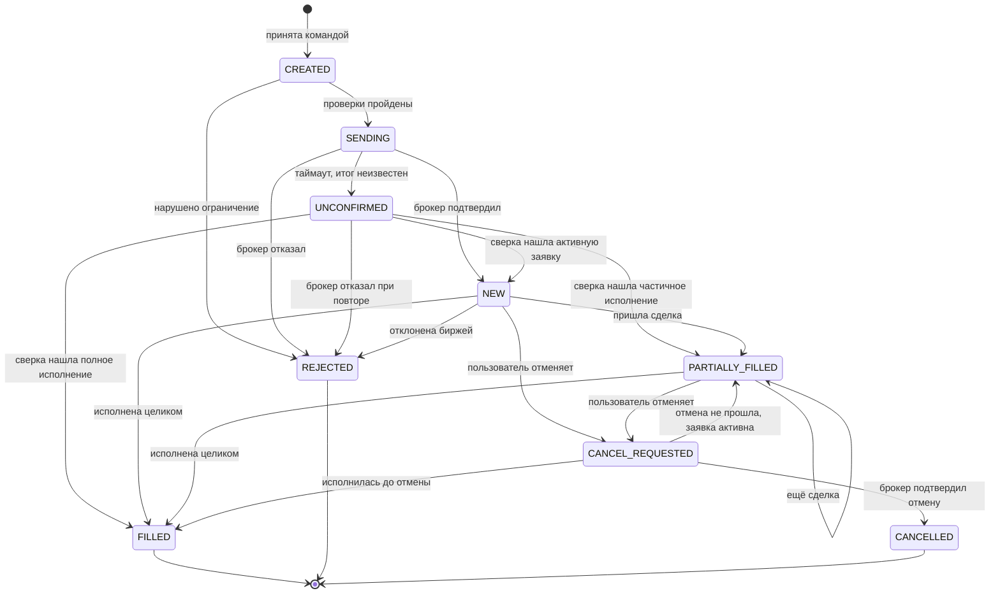

# 03. Модель состояний заявки

## Диаграмма

## Описание состояний

| Состояние | Смысл | Терминальное | Что видит пользователь |
|---|---|---|---|
| `CREATED` | Команда принята, ещё не отправлена | нет | «Принято» |
| `SENDING` | Идёт отправка брокеру | нет | «Отправляется» |
| `UNCONFIRMED` | Итог отправки неизвестен | нет | «Итог уточняется» |
| `NEW` | Активна, ещё не исполнялась | нет | «Активна» |
| `PARTIALLY_FILLED` | Часть объёма исполнена | нет | «Исполнена частично: X из Y» |
| `CANCEL_REQUESTED` | Отмена запрошена, не подтверждена | нет | «Отменяется» |
| `FILLED` | Исполнена полностью | да | «Исполнена» |
| `CANCELLED` | Отменена (возможно после частичного исполнения) | да | «Отменена» |
| `REJECTED` | Отклонена нами или брокером | да | «Отклонена: причина» |

## Соответствие статусам брокера

| Статус брокера ⚠️ | Состояние OrderGuard |
|---|---|
| `NEW` | `NEW` |
| `PARTIALLYFILL` | `PARTIALLY_FILLED` |
| `FILL` | `FILLED` |
| `CANCELLED` | `CANCELLED` |
| `REJECTED` | `REJECTED` |

Названия сверить с актуальным контрактом. Правило: **внутренние состояния не равны внешним**, потому что нам нужны `CREATED`, `SENDING`, `UNCONFIRMED` и `CANCEL_REQUESTED`, которых у брокера нет.

## Правила переходов

1. **Терминальные состояния не меняются.** Любое событие после `FILLED`, `CANCELLED` или `REJECTED` игнорируется и пишется в журнал расхождений.
2. **Исполнение сильнее отмены.** Если событие исполнения приходит в `CANCEL_REQUESTED`, побеждает исполнение.
3. **События могут приходить не по порядку.** Рыночная заявка может дать `FILLED` раньше, чем мы обработали `NEW`. Переход `SENDING`/`UNCONFIRMED` → `FILLED` допустим напрямую.
4. **Накопленный объём только растёт.** Событие с меньшим накопленным объёмом, чем у нас, считается устаревшим и отбрасывается.
5. **Каждый переход пишется в журнал** с причиной, источником (команда пользователя, стрим, сверка) и временем.
6. **`UNCONFIRMED` не должен жить долго.** Через 60 секунд без разрешения поднимается алерт.

## Порядок и дедупликация событий

Ключ дедупликации события исполнения: `(идентификатор заявки, идентификатор сделки)`; если идентификатора сделки нет, используется `(идентификатор заявки, накопленный объём)`. Повторная доставка того же события не меняет состояние и не создаёт уведомление.
