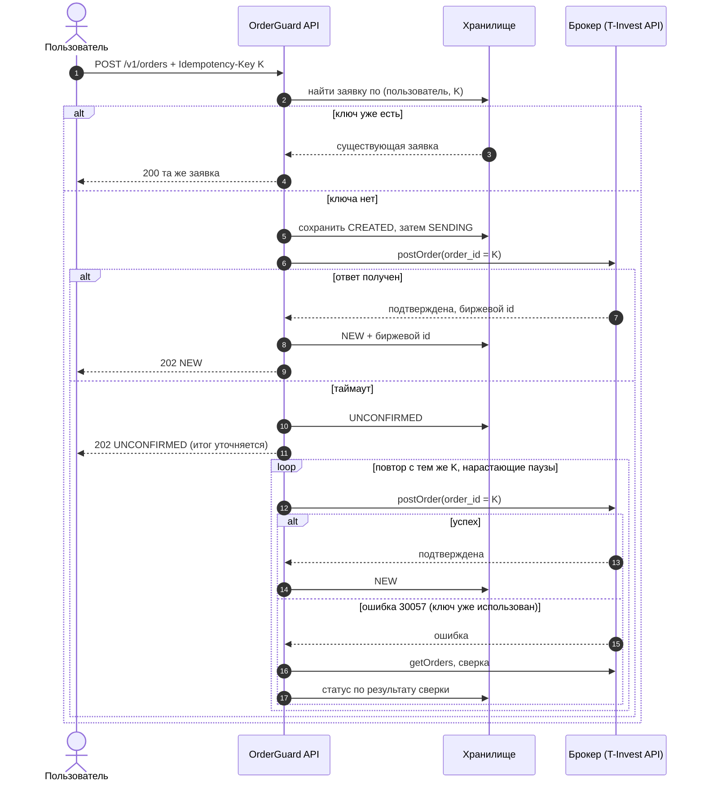
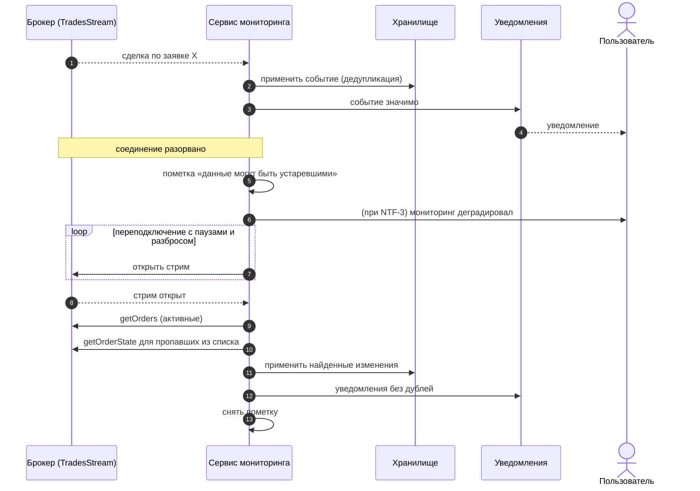
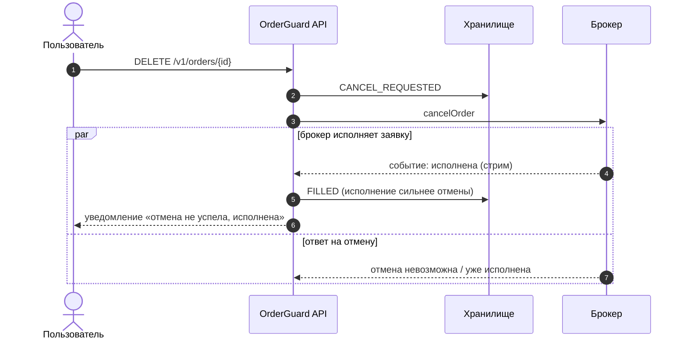
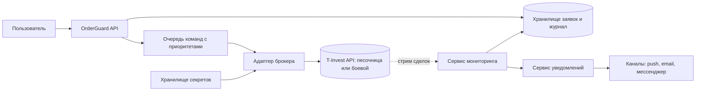

# 04. Интеграция с брокером: диаграммы последовательностей

## 4.1. Выставление заявки с таймаутом и безопасным повтором

Идея: **повтор безопасен только с тем же ключом**. Новый ключ означал бы новую заявку.

## 4.2. Стрим исполнения, обрыв и сверка

## 4.3. Отмена, пока заявка исполняется

## 4.4. Контекст системы

## 4.5. Принципы интеграции

| Принцип | Как реализуем |
|---|---|
| Идемпотентность на нашей стороне | Ключ клиента хранится и сравнивается по параметрам; на брокера отправляется как `order_id` |
| Сначала записать, потом отправить | Состояние `SENDING` сохраняется до вызова брокера, чтобы после сбоя было известно, что команда могла уйти |
| Таймауты и повторы | Таймаут на вызов, повтор только с тем же ключом, нарастающая пауза с разбросом |
| Одно окно записи | Изменения состояния заявки идут через одну точку, чтобы стрим, сверка и пользователь не конфликтовали |
| Сверка как страховка | Стрим считается быстрым, но не надёжным каналом; истину устанавливает сверка |
| Приоритеты | Отмена важнее отправки, отправка важнее сверки |
