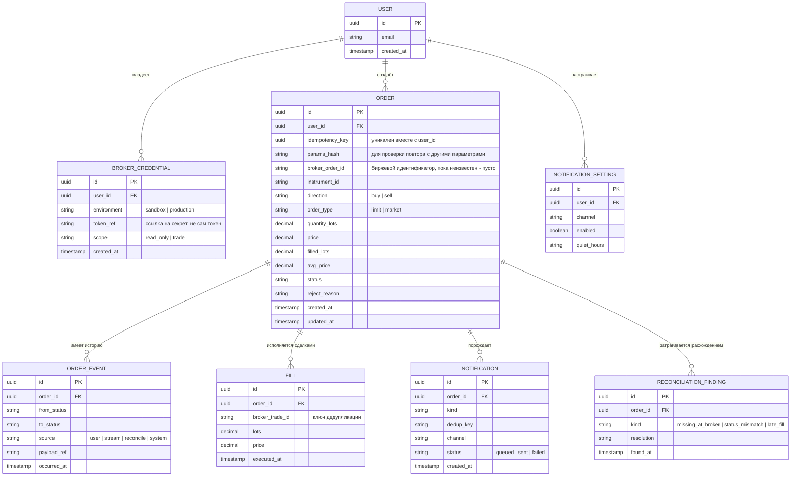

# 07. Модель данных

## ER-диаграмма

## Словарь ключевых полей

| Поле | Правило |
|---|---|
| `ORDER.idempotency_key` | UUID от клиента; уникальный индекс `(user_id, idempotency_key)`; хранится дольше, чем срок отслеживания у брокера (1 месяц) |
| `ORDER.params_hash` | Хеш параметров команды; при повторе с тем же ключом сравнивается, различие даёт `409` |
| `ORDER.broker_order_id` | Заполняется только после подтверждения; для `UNCONFIRMED` пусто |
| `ORDER.status` | Одно из состояний из [03](03-order-state-machine.md) |
| `ORDER.filled_lots` | Накопленный объём; только растёт |
| `FILL.broker_trade_id` | Уникален в рамках заявки; дедупликация повторной доставки |
| `NOTIFICATION.dedup_key` | `(order_id, вид события, накопленный объём)`; одно уведомление на событие |
| `BROKER_CREDENTIAL.token_ref` | Ссылка на запись в хранилище секретов; сам токен в базе не лежит |

## Правила целостности

1. Пара `(user_id, idempotency_key)` уникальна.
2. Изменение `ORDER.status` и запись в `ORDER_EVENT` происходят в одной транзакции.
3. `filled_lots` равно сумме `FILL.lots` по заявке.
4. `FILL.broker_trade_id` уникален внутри заявки.
5. `BROKER_CREDENTIAL` с `scope = read_only` не может использоваться для торговых команд.

## Хранение и удаление

| Данные | Срок | Основание |
|---|---|---|
| Заявки, события, сделки | не менее 5 лет (допущение) | Аудит и разбор споров |
| Токен брокера | До отзыва пользователем | Минимизация: удаляется по запросу и при удалении аккаунта |
| Журналы запросов | 90 дней, без токенов и персональных данных | Диагностика |
